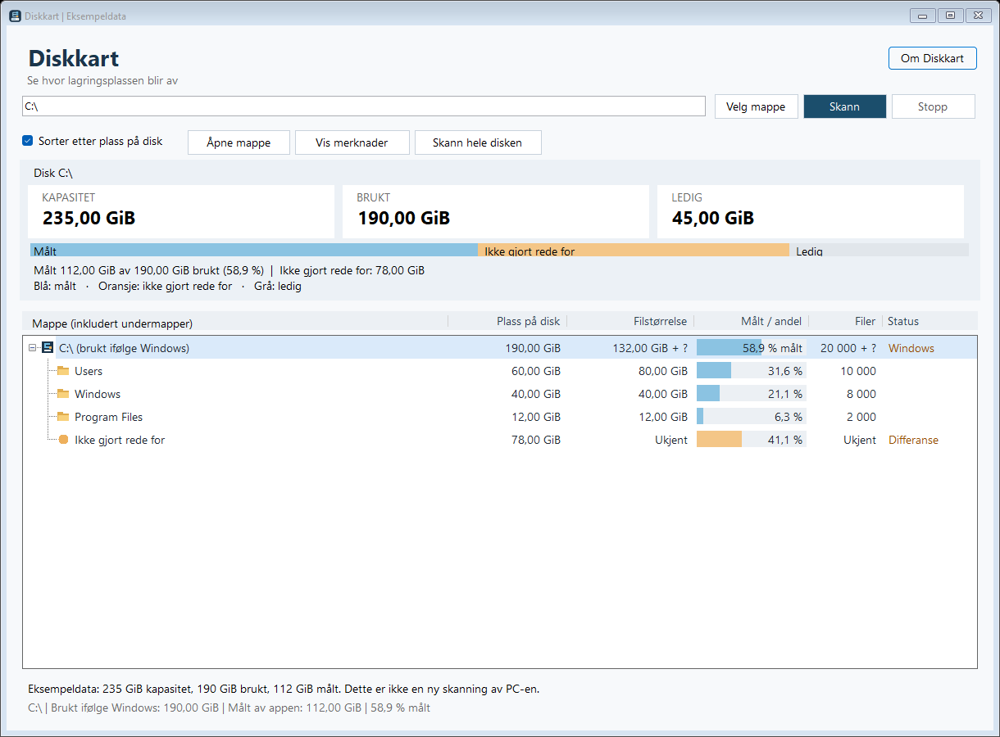

# Diskkart

Diskkart er et lite, portabelt Windows-program som viser hvor mye plass mapper bruker, inkludert undermappene. Det kan brukes når du trenger en rask oversikt uten å installere et separat diskverktøy.



Skjermbildet viser eksempeldata, ikke en skanning av en virkelig disk.

## Bruk

Last ned eller kopier `Diskkart.exe`, og start filen. Velg en mappe eller skriv inn en sti som `C:\`, og velg **Skann**. Mappetreet sorteres med de største mappene øverst. Du kan velge mellom filstørrelse og faktisk plass på disk.

Ved skanning av hele en disk viser programmet kapasitet, brukt og ledig plass fra Windows. Det viser også hvor mye av den brukte plassen som ble målt i mappetreet, slik at en forskjell ikke forveksles med en synlig mappe.

Diskroten viser for eksempel **58,9 % målt**, mens undermappene viser sin andel av brukt plass. Blått er målt, oransje er ikke gjort rede for, og grått er ledig.

Dra skillelinjene i kolonneoverskriftene for å justere breddene. Diskkart husker siste skannede mappe, vindusstørrelse, kolonnebredder og sortering. Innstillingene lagres i `%LOCALAPPDATA%\Diskkart\settings.xml`. Skanneresultater lagres ikke. Programmet har ingen telemetri.

## Krav

Programmet er laget for 64-biters Windows og bruker .NET Framework 4.5 eller nyere som allerede følger med moderne Windows-installasjoner. Det krever ikke installasjon.

## Bygge fra kildekode

Åpne PowerShell i denne mappen og kjør:

```powershell
.\Build.ps1
```

Byggeskriptet bruker C#-kompilatoren som følger med .NET Framework. Det oppretter `Diskkart.exe` og genererer ikonet fra kildekoden dersom `assets\Diskkart.ico` ikke finnes.

## Tester

Kjør med PowerShell 7 eller nyere:

```powershell
.\Test.ps1
```

Testene oppretter en egen, midlertidig mappe under `work`, med Unicode-navn, tomme mapper, en lenke tilbake til roten og en mappe med sperret lesetilgang. Den fjernes når testen er ferdig.

## Avgrensninger

- Programmet hopper over symbolske lenker, junctions og andre reparse points, slik at mapper ikke telles flere ganger eller skanningen havner i en løkke.
- OneDrive/Cloud Files-mapper er unntatt fra regelen om å hoppe over reparse points og kan gjennomgås.
- Mapper uten lesetilgang markeres som ukjente. Windows oppgir vanligvis ikke en total størrelse for innholdet uten at det kan leses.
- «Ikke gjort rede for» er brukt plass ifølge Windows minus målte mapper. Den kan inneholde utilgjengelige filer, filsystemdata, skyggekopier, systemfiler og måleavvik. Den kan ikke tolkes som størrelsen på én bestemt skjult mappe.
- OneDrive-filer er ikke verifisert på en maskin med Files On-Demand. Rapportert filstørrelse og lokal plassbruk kan derfor avvike for slike filer.
- Hardlenker kan ha flere filnavn til samme data. Diskkart teller hvert filnavn det møter.

## Videreutvikling

Kildekoden ligger i `src`. Bygge- og testskriptene skal gjøre det enkelt å gjenskape den portable exe-filen på en annen Windows-maskin.

GitHub Actions-oppsettet bygger og tester på Windows og lagrer exe-filen som et byggartefakt. Oppsettet er klargjort, men er ikke kjørt på GitHub ennå.
